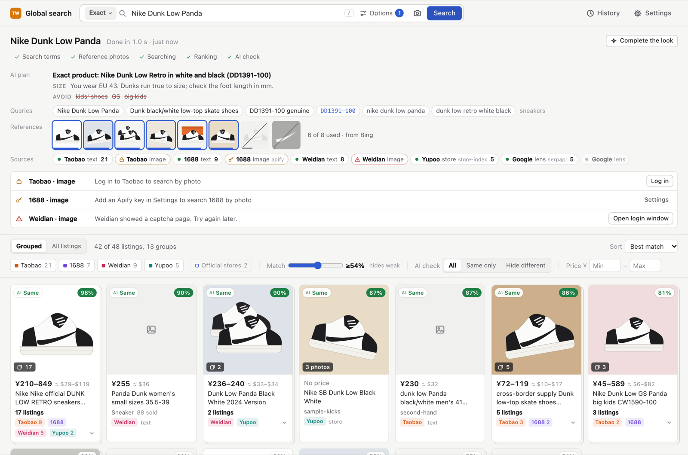

# OpenSearch

Find a product on Chinese marketplaces by name, by photo, or both. The app searches
**Taobao (and Tmall), 1688, Weidian and Yupoo**. It ranks every listing by how much its
photo looks like the item, and it groups the same product from different sellers.
Chinese titles show in English.

It runs on your own computer, with the AI provider of your choice.



## What it does

- **Search by name, photo or both.** Names on these sites are often wrong or in Chinese,
  so the photo match decides the order.
- **Groups sellers.** The same product from 17 sellers is one card with a price range.
- **English everywhere.** Titles, shop names and search terms are translated. Point at a
  translated text to see the Chinese.
- **Search modes.** *Exact product*, *Similar style*, or *Cheaper alternatives* (the same
  look without the brand; logo copies are flagged and ranked lower).
- **Clothing options.** Category, colors, fit, materials, size, price, about 110 brands
  with the Chinese names sellers use, and about 18 style presets.
- **Shop the look.** Drop an outfit photo. The AI finds each piece and searches for it.
- **AI stylist.** Starter kits for a style, "complete the look", or free-text requests.
- **Your currency.** Prices show in yuan plus an estimate in your own currency.

## Quick start

You need:

- [uv](https://docs.astral.sh/uv/getting-started/installation/) (it installs Python for you)
- [Node.js](https://nodejs.org) 22 or newer
- [Google Chrome](https://www.google.com/chrome/) (for Taobao and 1688)

```sh
git clone https://github.com/SergeSerb2/OpenSearch.git
cd OpenSearch
scripts/start.sh
```

On Windows, run `powershell -ExecutionPolicy Bypass -File scripts\start.ps1`.

Open **http://127.0.0.1:8790**, then go to **Settings → AI provider** to connect an AI.
The first start downloads the image model (about 800 MB).

## Connect an AI provider

The AI writes Chinese search terms, checks photos, translates titles and runs the
stylist. Search still works without it, with fewer features.

In the app, open **Settings → AI provider**. Pick a provider, paste a key and click
**Test connection**. The test lists the provider's models and checks that the model
can read photos. Then click **Save**.

| Provider | Cost | Reads photos | Get started |
|---|---|---|---|
| Google Gemini | free tier | yes | [Get a key](https://aistudio.google.com/apikey) |
| Ollama | free, on your computer | with a vision model | [Install](https://ollama.com/download), then `ollama pull qwen2.5vl:7b` |
| LM Studio | free, on your computer | with a vision model | [Install](https://lmstudio.ai), load a model, start the server |
| OpenAI | pay per use | yes | [Get a key](https://platform.openai.com/api-keys) |
| Anthropic Claude | pay per use | yes | [Get a key](https://console.anthropic.com/settings/keys) |
| OpenRouter | pay per use, some free models | depends on the model | [Get a key](https://openrouter.ai/keys) |
| DeepSeek | cheap | no | [Get a key](https://platform.deepseek.com/api_keys) |
| Other | | | any OpenAI-compatible API: LiteLLM, vLLM, Groq, Together, Azure, CLIProxyAPI… |

Pick a model that reads photos if you can. Without one, the app turns photo checks and
Shop the look off. Everything else works.

You can also set the provider in `.env` (see [`.env.example`](.env.example)):

```sh
LLM_PROVIDER=gemini
LLM_API_KEY=your-key
LLM_MODEL=gemini-flash-latest
```

## Optional keys

Each key turns on more sources. Add them in **Settings → API keys**.

| Service | What it adds | Cost |
|---|---|---|
| [Serper](https://serper.dev) | Google Images for reference photos, Google Lens, and `site:` search that finds Yupoo and Weidian pages | 2,500 free searches |
| [SerpApi](https://serpapi.com) | The same, used when Serper fails | 250 free searches a month |
| [Apify](https://apify.com) | Photo search on 1688 | about $0.015 a search, from Apify's $5 monthly credit |
| [Qualit.ly](https://qualit.ly) | Extra listings with QC photos | free plan |

Without Serper or SerpApi, reference photos come from Google in the search browser, or from Bing.

## Marketplace logins

Taobao and 1688 only show search results to logged-in users. Use a separate account,
not your main one: automated searches can cause a temporary block.

1. Open **Settings** and click **Log in** next to Taobao.
2. A Chrome window opens. Log in (the QR code in the Taobao app is the easiest way).
3. Click **Done** in the app. Searches then run in a Chrome window that stays minimized
   (Taobao shows a slider check to hidden browsers).

One Taobao account also works for 1688. The login is saved in `data/browser-profile`.

### Yupoo stores

Yupoo has no global search, so the app searches a list of stores that you choose in
**Settings → Yupoo stores**. The list starts empty. With a Serper or SerpApi key, the app
also finds albums in stores that are not in your list.

## How a search works

1. **Search terms.** The AI turns the name and options into Chinese and English search
   terms, and finds style codes such as `DD1391-100`. With only a photo, it first names
   the item.
2. **Reference photos.** The app gets about 8 photos of the item from Google Images or
   Bing. It keeps the photos that agree with each other, and the AI removes photos of
   other colorways. You can change the selection; results are ranked again.
3. **Marketplace search.**

   | Source | By name | By photo |
   |---|---|---|
   | Taobao / Tmall | site search (login) | not yet |
   | 1688 | site search (login) | Apify |
   | Weidian | Qualit.ly, links from Yupoo and Google | Google Lens |
   | Yupoo | your store list, Google `site:` search | Google Lens |

4. **Ranking.** A product-image model ([Marqo e-commerce CLIP](https://huggingface.co/Marqo/marqo-ecommerce-embeddings-B))
   compares each listing photo with the reference photos, on your GPU if there is one.
5. **Grouping.** Listings with nearly the same photo, or the same style code, become one
   group.
6. **AI check.** The AI looks at the best listings and marks each one *same*, *variant*
   (other color or model) or *different*.

## Configuration

Everything is optional. The app writes the AI and key settings for you; the rest is in
`.env` (see [`.env.example`](.env.example)). A value in `.env` wins over the same
variable in your shell.

| Variable | Default | What it does |
|---|---|---|
| `LLM_PROVIDER`, `LLM_BASE_URL`, `LLM_API_KEY`, `LLM_MODEL` | none | The AI provider. |
| `LLM_VISION` | `auto` | `off` never sends photos to the AI. |
| `LLM_TIMEOUT` | `1` | Multiplies AI timeouts, for example `3` for a slow local model. |
| `SERPER_API_KEY`, `SERPAPI_API_KEY`, `APIFY_TOKEN`, `QUALITLY_API_KEY` | none | Optional services. |
| `FINDER_PORT` | `8790` | Port. |
| `FINDER_HOST` | `127.0.0.1` | Listen address. Do not expose it without `FINDER_PASSWORD`. |
| `FINDER_PASSWORD` | none | Password for remote access (see [Remote access](#remote-access)). |
| `FINDER_AUTH` | `remote` | `all` also asks for the password on `127.0.0.1` (for servers). |
| `FINDER_ALLOWED_HOSTS` | none | Extra host names the app answers to, comma-separated. |
| `BROWSER_MODE` | `minimized` | `minimized`, `visible` or `hidden`. Taobao blocks `hidden`. |
| `EMBED_MODEL` | Marqo e-commerce B | The open_clip image model. |

## Platforms

Mostly tested on macOS (Apple Silicon). Linux and Windows should work:

- The image model runs on an NVIDIA GPU (CUDA), an Apple GPU, or the CPU.
- On Linux without a screen, the search browser runs hidden, and Taobao may block it.
- Without Google Chrome, run `cd server && uv run patchright install chromium`. Chromium
  passes the sites' bot checks less often than Chrome.

## Remote access

The app has an optional password for use from another computer or your phone. Set it in
`.env`:

```sh
FINDER_PASSWORD=a-long-password
FINDER_ALLOWED_HOSTS=finder.example.com   # the public host name
```

Requests to `127.0.0.1` on your own computer stay open. Everything that arrives through
another host name needs the password; the login lasts 30 days per browser. After 10 wrong
passwords, a client must wait 10 minutes.

**From your own computer, with a tunnel** (everything works, including Taobao, while the
computer is on). With [Cloudflare Tunnel](https://developers.cloudflare.com/cloudflare-one/connections/connect-networks/):

```sh
cloudflared tunnel create finder
cloudflared tunnel route dns finder finder.example.com
cloudflared tunnel run --url http://127.0.0.1:8790 finder
```

**On a server** (always on). The `Dockerfile` and `fly.toml` deploy to [Fly.io](https://fly.io).
The server has no screen, so Taobao and 1688 site search mostly hit slider checks there;
the other sources work. In `fly.toml`, replace `your-app-name` with your own app name, then:

```sh
fly apps create your-app-name
fly volumes create finder_data --size 3
fly secrets set FINDER_PASSWORD=... LLM_PROVIDER=gemini LLM_API_KEY=... LLM_MODEL=gemini-flash-latest
fly deploy
```

`fly.toml` sets `FINDER_AUTH=all`, so the server always asks for the password. It needs
about 4 GB of memory and sleeps when nobody uses it.

## Privacy and security

- Everything stays on your computer: searches, photos, logins and keys are in `data/`
  and `.env`. There is no telemetry.
- Your AI provider receives the search text, reference photos, listing photos and
  titles. Use a local model (Ollama, LM Studio) to keep them private.
- The server only accepts requests from its own pages: other websites you visit cannot
  use it. Keys are never shown again after you save them.
- For access from other devices, set `FINDER_PASSWORD` (see [Remote access](#remote-access)).

## Responsible use

This is a search tool. Respect the terms of the sites you search and the trademarks of
the brands you look for. Searches run at a human pace; do not change that. The authors
do not endorse counterfeit goods. *Cheaper alternatives* mode flags listings that copy a
brand's logo.

Links go to the original listings. Listing pages are in Chinese; use your browser's
Translate on them.

## Development

```sh
scripts/dev.sh     # backend on :8790, Vite dev server with hot reload on :5173
```

Add `?mock=1` to the URL for a fake backend that needs no logins, keys or AI. See
[CONTRIBUTING.md](CONTRIBUTING.md).

```
server/   Python backend (FastAPI): search pipeline, sources, ranking, AI calls
web/      React web app (Vite, TypeScript)
docs/     API.md (backend API) and research notes on marketplace APIs
scripts/  start.sh, dev.sh, start.ps1
data/     created at run time: cache, searches, browser profile (gitignored)
```

## License

[MIT](LICENSE)
